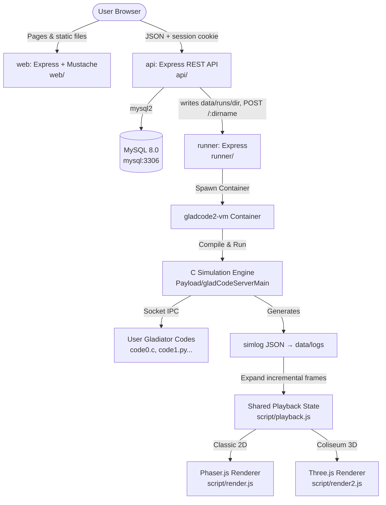

# gladCode 2

gladCode is a web-based programming game and arena where players code AI gladiators in C or Python to battle autonomously. The platform replays every battle in the Three.js top-down 3D coliseum, with the Phaser.js 2D arena as the automatic fallback, and offers visual block-based programming (Blockly), raw C/Python editing (ACE Editor), ranked battles, duels, tournaments and classroom trainings.

**Documentation:** [INDEX.md](INDEX.md) maps every document. Start with [GUIDE.md](GUIDE.md) for the architecture and [TESTING.md](TESTING.md) for the validation commands; [AGENTS.md](AGENTS.md) holds the rules agents follow, [CONTRIBUTING.md](CONTRIBUTING.md) the branch and commit conventions, and [docs/frontend/](docs/frontend/README.md) the frontend conventions.

---

## 📐 Architecture Overview

gladCode 2 runs as Node.js services managed via **Docker Compose**:



---

## 🛠️ Services

| Service | Location | Tech Stack | Role & Responsibilities |
| :--- | :--- | :--- | :--- |
| **Web** | `web/` | Node.js, Express, Mustache, native ES modules, Phaser.js, Three.js | Page shells, static files, the frontend modules and both battle renderers. Never sees the session |
| **API** | `api/` | Node.js, Express, mysql2, jose, nodemailer, Vitest | REST API: Google sign-in, gladiators, battles, rankings, social, tournaments, trainings, admin tools ([reference](docs/api/README.md)) |
| **Runner** | `runner/` | Node.js, Express, Docker CLI | Battle executor: starts each battle in an isolated `gladcode2-vm` container through the host's Docker socket |
| **Simulation Engine** | `Payload/` | C (GCC, pthreads, sockets) | Multi-threaded arena server executing turn-by-turn combat between gladiator programs |
| **Database** | `mysql` service, `migrations/` | MySQL 8.0 | Accounts, gladiators, tournaments, battle log index, stats |

---

## ⚡ Quick Start & Development Environment

> [!NOTE]
> **No Local Node/Python Requirement**: Node.js and Python are not required on the host machine. All services, scripts, and compilers run inside Docker containers.

### Prerequisites
- [Docker Desktop](https://www.docker.com/) (or Docker Engine + Docker Compose plugin)
- The `gladcode2-vm` engine image: `docker build -t gladcode2-vm Setup`
- The licensed Synty packs in `web/public/assets/synty/` for the 3D renderer (optional: the 2D replay works without them)

### 1. Environment

```bash
cp .env.example .env
```

Fill in the MySQL credentials, `JWT_SECRET` and `GOOGLE_CLIENT_ID`. For development add:

```bash
COMPOSE_FILE=compose.yaml:compose.dev.yaml   # run web/, api/ and runner/ from source with node --watch
WEB_PUBLISH=8085                             # host ports
API_PUBLISH=8086
WEB_PORT=8085                                # ports in the public URLs
API_PORT=8086
ADMIN_EMAILS=you@example.com                 # dev tools and the release page
```

Every setting comes from `.env`; there are no config files.

### 2. Launching Services

```bash
docker compose up -d
MAILER_USER= docker compose up -d api   # keep emails from reaching real users while testing
```

- **Site**: [http://localhost:8085](http://localhost:8085)
- **API**: [http://localhost:8086/health](http://localhost:8086/health) ([reference](docs/api/README.md))
- **Dev tools** (administrators): [http://localhost:8085/dev-tools](http://localhost:8085/dev-tools)
- **Runner**: internal only (`http://runner:3000`)

Sign in with Google, or locally print a session cookie for an account and set it as `app_session` for `localhost`:

```bash
docker compose exec -T api node scripts/issue-session.js <userId>
```

---

## 🗄️ Database & Dev Tools

```bash
./migrations/migrate.sh                 # apply the numbered SQL files in migrations/
dev-tools/dump_restore.sh dump          # dev-tools/dump_gladcode.sql
dev-tools/dump_restore.sh restore
dev-tools/tournament.sh help            # test tournaments, round resets, export/import
```

See [dev-tools/README.md](dev-tools/README.md).

### Lint & Tests

```bash
docker run --rm -v "$PWD":/w -v /w/node_modules -w /w node:22-alpine sh -c "npm ci && npm run lint && npm test"   # lint (web + api), frontend tests
docker compose exec -T api npx vitest run                                                  # API tests
bash tests/engine/run.sh                                                                   # engine regression battles
```

Every command, what it covers and the tests that need the running stack are in [TESTING.md](TESTING.md).
Coding rules are in [AGENTS.md](AGENTS.md); the architecture is in [GUIDE.md](GUIDE.md). Branches, commit
messages and how work is merged are described in [CONTRIBUTING.md](CONTRIBUTING.md).

---

## ⚔️ How Gladiator Battles Work

1. **Code Creation**: Users write C or Python gladiator algorithms in the editor (`/editor`) using either visual blocks or text editing.
2. **Security Verification**: When a gladiator is saved, its code is checked against `api/banned_functions.json`, and the API runs a test battle to prove it compiles and runs.
3. **Execution Request**: The API's `model/battle.js` prepares a run folder in `data/runs/<dir>` with the `Payload/` files and each gladiator's code (`code0.c`, `code1.py`, ...), then sends an HTTP POST to `http://runner:3000/<dir>`.
4. **Container Isolation**: The runner spawns a `gladcode2-vm` container with restricted CPU (`--cpu-quota=50000`) and a 30-second execution deadline.
5. **Simulation Execution**: `socket_compile.sh` compiles gladiator code, launches `gladCodeServerMain`, and manages socket IPC between gladiators and the C game engine.
6. **Results**: The API stores the simlog in `data/logs/<id>` and applies the battle's rules (renown and silver for ranked battles, deaths and placings for tournaments, scores for trainings).
7. **Log Replay**: `script/playback.js` expands the incremental trace into complete frames and runs the top-down Three.js renderer (`script/render2.js`); browsers without WebGL2, `ENABLE_RENDER2=0`, or a failed 3D start fall back to the classic Phaser renderer (`script/render.js`). The 3D renderer dresses each gladiator in Synty modular models mapped and recoloured from its persisted skin, walking with a distance-driven gait and playing Synty animation clips for melee, ranged, spell, block and charge actions timed on the replay clock (pausing freezes them; replay speed scales them). Both renderers use the same 100 ms simulation cadence and authoritative arena coordinates.

---

## 📁 Repository Structure

```
gladcode2/
├── .github/                 # Deploy workflow & Copilot instructions
├── .agents/skills/          # Project skills for agents (indexed in .agents/skills/README.md)
├── INDEX.md                 # Map of every document
├── GUIDE.md                 # Architecture and ownership boundaries
├── TESTING.md               # Validation commands and test scope
├── AGENTS.md                # Architecture and coding rules for agents and developers
├── CONTRIBUTING.md          # Branches, commit messages and merging
├── compose.yaml             # Production images; compose.dev.yaml adds source mounts and node --watch
├── api/                     # REST API: route/, model/, helpers/, middleware/, scripts/, tests/
├── web/                     # Web service: app.js, view/ (Mustache), public/ (static files)
│   └── public/script/       # ES module pages, components, models, templates; Phaser and Three.js renderers
├── runner/                  # Express service that starts each battle through the host Docker (Docker CLI)
├── Payload/                 # C battle simulation engine & socket API source
├── migrations/              # Numbered SQL migrations and their runner
├── dev-tools/               # Tournament CLI, database dump/restore, release news SQL
├── docs/                    # API reference (generated), design system, design boards, frontend conventions
├── tests/                   # Frontend, render2, migration and engine tests
└── data/                    # Battle logs, run folders, profile pictures (gitignored)
```

---

## 🚀 Deploying

`compose.yaml` builds and runs the production images; the GitHub workflow (`.github/workflows/master-deploy.yml`) pulls `main` on the server, stops when `JWT_SECRET`, `WEB_PUBLISH` or `API_PUBLISH` is missing from `.env`, moves the PHP stack's `public_html/logs` and `public_html/profpics` into `data/` (once, never overwriting), builds, runs the migrations and then restarts with `--remove-orphans`, so new code never meets the old schema. On the server:

- Set `NODE_ENV=production`, `WEB_URL=https://gladcode.dev`, `WEB_PORT=443`, `API_URL=https://api.gladcode.dev`, `API_PORT=443`, `WEB_PUBLISH`/`API_PUBLISH` (for example `127.0.0.1:8085` and `127.0.0.1:8086`), `TRUST_PROXY=true`, a random `JWT_SECRET` and `ADMIN_EMAILS`.
- Route `gladcode.dev` to the web port and `api.gladcode.dev` to the API port in the host nginx (with TLS).
- Keep the Synty packs in `web/public/assets/synty/` and the data in `data/logs`, `data/profpics` and `data/runs` (the first deploy moves the old ones there).
- Expire old battle logs from the host crontab: `docker compose exec -T api node scripts/remove-old-battles.js`.

---

## 🛡️ Security & Constraints

- User code runs in unprivileged Docker containers (`gladcode2-vm`).
- CPU execution capped at 50% single core per battle.
- 30-second hard wall-clock timeout enforced by `runner/runner.js`.
- Forbidden functions (`setPosition`, `setHp`, `setAp`, `lvlUp`, etc.) are refused when gladiators are saved and only work in editor test battles.
- Sessions are HttpOnly cookies; the API answers browsers only from the site's origin and refuses cookie changes from any other.
