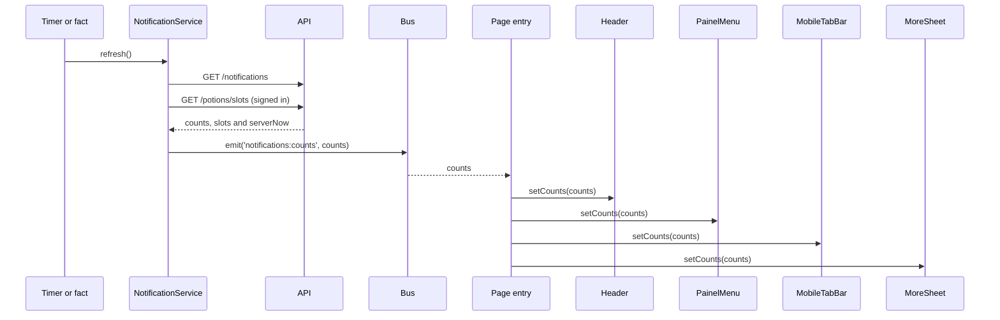
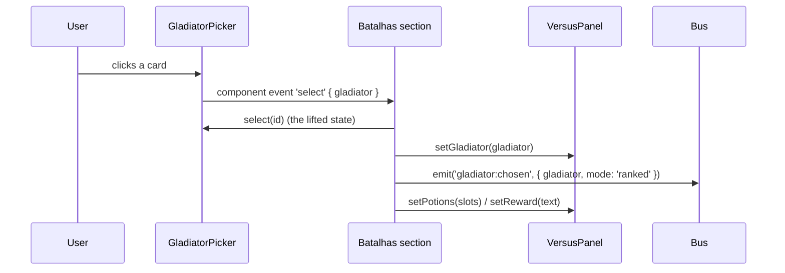
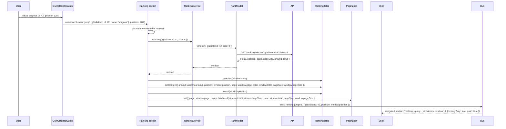
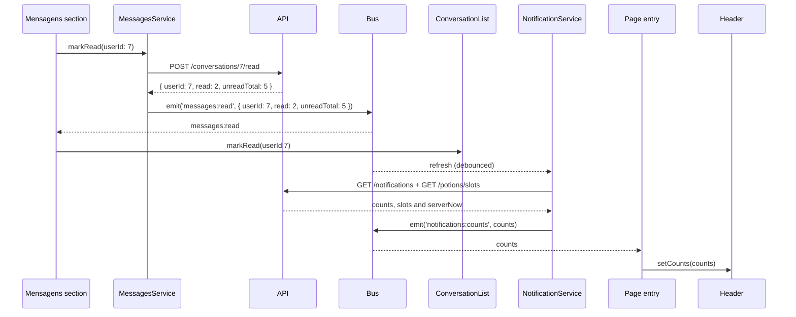
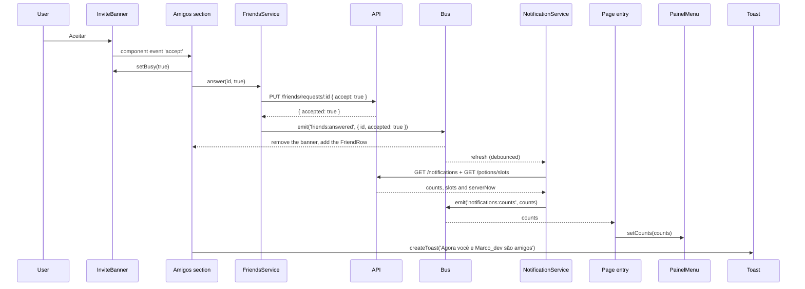
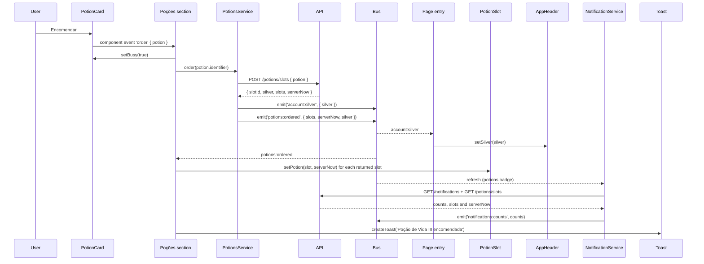
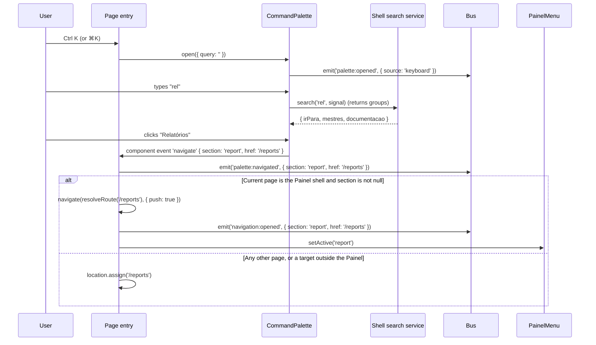

# Events

gladCode has two event levels, and they must not be confused:

| Level | Mechanism | Who owns it | Scope |
| :--- | :--- | :--- | :--- |
| **Component event** | A `CustomEvent` dispatched on the component's own root element, `bubbles: true` | The component | One subtree: a parent component or the section that mounted it listens |
| **App event** | The one DOM-free bus, `helpers/event-bus.js` | A service | The whole page: the shell, the header, the menu, the section and the tab bar |

A component event is not put on the bus. An app event is not a DOM event. Nothing else is allowed
(`document`-level `CustomEvent`s only survive until their consumers move to the bus; see
[Migration](#migration-of-the-existing-document-events)).

## Component events

- Name: a short verb in lower case — `select`, `change`, `save`, `undo`, `close`, `order`, `jump`,
  `navigate`, `retry`.
- Dispatched on the component root: `element.dispatchEvent(new CustomEvent('select', { detail, bubbles:
  true }))`.
- The `detail` payload is documented in [components.md](components.md) for each component.
- The parent either listens with `component.element.addEventListener('select', …)` (and `BaseComponent#on`
  for its own lifetime) or passes a method; there is no third way.
- Component events carry **view data** (the gladiator, the choice, the position), never a request, a
  service or an `AbortSignal`.

## The app event bus

`web/public/script/helpers/event-bus.js` is a single `EventTarget` wrapper. It is
DOM-free: it imports nothing and can be tested in `tests/frontend/`.

```js
// helpers/event-bus.js (implemented shape)
/**
 * @typedef {object} AccountSavedDetail
 * @property {object} user The account as the API returned it.
 * @property {string[]} changed The fields that changed.
 */
/**
 * @typedef {object} AccountSignOutFailedDetail
 * @property {unknown} error Why the logout request failed.
 */
// …one typedef per event…

/** The only event names the bus accepts. */
export const APP_EVENTS = Object.freeze({
    accountLoaded: 'account:loaded',
    accountSaved: 'account:saved',
    accountSilver: 'account:silver',
    accountSignedOut: 'account:signed-out',
    accountSignOutFailed: 'account:sign-out-failed',
    themeChanged: 'theme:changed',
    gladViewChanged: 'glad-view:changed',
    notificationsCounts: 'notifications:counts',
    navigationOpened: 'navigation:opened',
    messagesRead: 'messages:read',
    friendsAnswered: 'friends:answered',
    potionsOrdered: 'potions:ordered',
    potionsReconciled: 'potions:reconciled',
    potionsCancelled: 'potions:cancelled',
    gladiatorChosen: 'gladiator:chosen',
    rankingJumped: 'ranking:jumped',
    paletteOpened: 'palette:opened',
    paletteNavigated: 'palette:navigated',
});

/** @type {{ on(name: string, handler: (detail: any) => void, options?: { signal?: AbortSignal }): () => void, emit(name: string, detail?: any): void }} */
export const events = new EventBus();
```

Contract:

- `on(name, handler, { signal })` returns an unsubscribe function. When `signal` is passed,
  `addEventListener(name, listener, { signal })` unsubscribes on abort; the returned function also works.
  A section passes its own `AbortController.signal` and does not have to track subscriptions.
- `emit(name, detail)` dispatches `new CustomEvent(name, { detail })`; it is synchronous.
- The name must be one of `APP_EVENTS`' values. `on()` and `emit()` throw on an unknown name in
  development and in tests, so a typo fails the suite instead of silently doing nothing.
- A handler receives the `detail` object, not the `CustomEvent`.
- `events` is the only instance application code uses; tests may construct an isolated `EventBus`.
- **App events are consumed by services and the shell/page entry**; a component receives data through its
  setters (`setCounts`, `setSilver`, `setRows`, …). The two global preference facts (`theme:changed`,
  `glad-view:changed`) are the exception: the components that repaint on them subscribe directly. A section
  may subscribe when the fact belongs to it (a message read, a potion ordered) and then updates its
  children through their setters.

### Event names, payloads, emitters and listeners

Naming: `domain:action`. A **fact** is past tense (`account:saved`, `messages:read`,
`notifications:counts`). A fact says what just happened, not what someone should do.

| Event | Payload | Emitted by | Listened by |
| :--- | :--- | :--- | :--- |
| `account:loaded` | `{ user }` | `AccountService.load()` | shell (then PainelMenu/AccountMenu setters), Settings section |
| `account:saved` | `{ user, changed: string[] }` | `AccountService.save()` | shell (header/menu identity), Settings section (`SaveStatus`), theme/glad-view helpers |
| `account:silver` | `{ silver }` | `AccountService.setSilver()` | shell → AppHeader/AccountMenu setters |
| `account:signed-out` | `{}` | `AccountService.signOut()` | shell (return to the visitor header), NotificationService (stop polling) |
| `account:sign-out-failed` | `{ error }` | `AccountService.signOut()` after the model rejects | shell (error toast with a retry; keep the account state) |
| `theme:changed` | `{ choice: 'system'\|'classic'\|'arena-light'\|'arena-dark', theme: 'classic'\|'arena-light'\|'arena-dark' }` | `helpers/theme.js` `applyTheme` | AccountMenu (pressed state), Settings section, any page that redraws on theme |
| `glad-view:changed` | `{ choice: 'sprite'\|'3d' }` | `helpers/glad-view.js` `applyGladView` | GladiatorCard/GladCardPainter, editor creator |
| `notifications:counts` | `NotificationCounts` (below) | `NotificationService.refresh()` | shell → AppHeader, PainelMenu, MobileTabBar, MoreSheet setters |
| `navigation:opened` | `{ section: SectionId, href: string }` | shell after a section mounts | shell → PainelMenu/MobileTabBar setters, analytics, the route title |
| `messages:read` | `{ userId: number, read: number, unreadTotal: number }` | `MessagesService.markRead()` | Mensagens section (updates `ConversationList`), NotificationService (refresh) |
| `friends:answered` | `{ id: number, accepted: boolean }` | `FriendsService.answer()` | NotificationService (refresh), Amigos section |
| `potions:ordered` | `{ slots: PotionSlotView[], serverNow: string, silver: number }` | `PotionsService.order()` | Poções section (updates `PotionSlot`), NotificationService; AppHeader via `account:silver` |
| `potions:reconciled` | `{ slots: PotionSlotView[], serverNow: string, silver: number }` | `PotionsService.reconcile()` | Poções section (ends “Atualizando…”, updates every slot); AppHeader via `account:silver` |
| `potions:cancelled` | `{ slotId: number }` | `PotionsService.cancel()` | Poções section |
| `gladiator:chosen` | `{ gladiator: GladiatorView, mode: 'ranked'\|'duel'\|'tournament'\|'training' }` | Batalhas section (after the picker's `select`) | Batalhas section itself for the URL, analytics |
| `ranking:jumped` | `{ gladiatorId: number\|null, position: number }` (`position` is the resolved window position) | Ranking section (after the table moved) | shell (URL/hash), analytics |
| `palette:opened` | `{ source: 'keyboard'\|'button' }` | shell | analytics, shell (header search busy state) |
| `palette:navigated` | `{ section: SectionId\|null, href: string }` | CommandPalette → shell | analytics, shell (menu pending state) |

Every numeric id above is the entity it names: `messages:read.userId` is **the other master's user id**
(the conversation key), `friends:answered.id` is the pending `friends` row id, `potions:*.slotId` and
`PotionSlotView.id` are the `slots` row id, `ranking:jumped.gladiatorId` is `gladiators.cod`, and
`gladiator:chosen.gladiator.id` is also `gladiators.cod`. A message id (`messages.id`) never keys a
conversation.

Payload typedefs:

```js
/**
 * The one payload of `notifications:counts`, produced by `NotificationService` after joining
 * `GET /notifications` with `GET /potions/slots`. Every listener reads the same fields.
 *
 * @typedef {object} NotificationCounts
 * @property {{ level: number, xp: number, silver: number }} user
 * @property {number} messages Unread private messages.
 * @property {number} news Unread news posts.
 * @property {number} friends Pending friend requests.
 * @property {{ remaining: number, outdated: number }} gladiators
 * @property {number} duels Pending duel challenges.
 * @property {{ ranked: number, duel: number }} reports Unread ranked and duel reports.
 * @property {{ count: number, nextExpiry: string|null, serverNow: string }} potions
 *   Active potion slots, the soonest `expiresAt` (or null) and the server time of that answer.
 * @property {number} bell The bell total: `duels + friends + reports.ranked + reports.duel + news`.
 */

/**
 * One potion compartment. `GET /potions/slots` returns `expiresAt` and `serverNow` from WP3 (the shell's
 * badge needs them); the Poções section consumes them from WP6.
 *
 * @typedef {object} PotionSlotView
 * @property {number} id
 * @property {string} identifier
 * @property {string} name
 * @property {string} icon
 * @property {string} expiresAt Server-time timestamp (`YYYY-MM-DD HH:MM:SS`).
 * @property {number} seconds Time left when the API answered.
 */

/**
 * The subset of a gladiator a component or event receives; `id` is `gladiators.cod`.
 *
 * @typedef {object} GladiatorView
 * @property {number} id
 * @property {string} name
 * @property {number} mmr
 * @property {string} skin
 */

/**
 * The ids `web/app.js` `PROFILE_TABS` uses. `/reports` maps to `report`; `/potion` maps to `potions`.
 *
 * @typedef {'news'|'profile'|'glads'|'potions'|'battle'|'report'|'ranking'|'messages'|'friends'} SectionId
 */
```

### What must never go through the bus

- **Parent → child calls.** A section that mounts a `VersusPanel`, a `RankingTable` or a `MessageThread`
  calls its methods (`setGladiator`, `setRows`, `append`). The bus is not a way to call a child.
- **Child → parent replies.** A component emits its own event; the parent handles it directly.
- **Request payloads and responses.** Services call models; the bus carries the resulting *fact* and the
  view data, not an `AbortSignal`, a `Request` or an error object. (A failure is the promise's rejection;
  the section decides what to show.)
- **Secrets or private data.** No session token (there is none in JavaScript), no raw API bodies, no
  e-mail addresses that the section did not already display.
- **Styling or layout.** A theme fact is a fact; components read the tokens. Nothing emits “make this
  red”.

## Flows

### 1. Notification counts → header bell, menu badges and tab bar badges

`NotificationService` is the only owner of the counts. It refreshes on load, every 30 s while the page is
visible, and when a fact that changes a count arrives (debounced to one request per burst). The same refresh
joins `GET /notifications` (the counters) with `GET /potions/slots` (the potion expiry), because the
notifications endpoint does not carry potions.



The bell's `aria-label` uses `counts.bell` (“Notificações, 4 novas”); a zero count removes the badge but
keeps the button. The menu badges use the three kinds from [components.md](components.md) (`action`,
`unread`, `info`): duels and friends are `action`, reports/news/messages are `unread`, and the counts
without an attention meaning (`4/6`, `#128`, the potion time) are `info`. The rail's potion badge reads
`counts.potions.count` and formats the time from `counts.potions.nextExpiry` against
`counts.potions.serverNow`.

The poll belongs to the **shell's lifetime**, not to a section: the shell starts `NotificationService` when
`account:loaded` reports a session, pauses it on `document.hidden`, resumes it on `visibilitychange` and
stops it on `account:signed-out`. Leaving a section never stops it, because the header, menu and tab bar
are outside the section.

The notification panel's rows are loaded when the panel opens, not on every poll: `NotificationService.feed()`
composes `needs` from `GET /duels` and `GET /friends` and `news` from `GET /reports?unreadOnly=true` and
`GET /news?offset=0&markRead=false`. The panel's own header shows `counts.bell`; the rows carry their own
destination.

### 2. Profile setting changed → autosave → toast with undo → theme/glad-view applied everywhere

Text fields save when they lose focus or after a 700 ms pause; choices (theme, glad view, language,
switches) save immediately. Every save goes through one queue per field, so the last intent wins even when
responses arrive out of order.

```mermaid
sequenceDiagram
    participant User
    participant Choice as ChoiceCards
    participant Section as Perfil section
    participant Svc as AccountService
    participant API
    participant Bus
    participant Shell as Page entry
    participant Header
    participant Toast
    User->>Choice: chooses Clássico
    Choice->>Section: component event 'change' { value: 'classic' }
    Section->>Section: applyTheme('classic') (preview at once)
    Section->>Svc: save('theme', 'classic')
    Svc->>Svc: token = { field: 'theme', rev: ++seq.theme, previous: confirmed.theme } (only one request in flight)
    Svc->>API: PUT /users/me { theme: 'classic' }
    API-->>Svc: { user }
    Svc->>Svc: confirmed.theme = 'classic'; rev === seq.theme, so the toast is due
    Svc->>Bus: emit('account:saved', { user, changed: ['theme'] })
    Svc->>Bus: emit('theme:changed', { choice: 'classic', theme: 'classic' })
    Bus-->>Shell: account:saved
    Shell->>Header: setAccount(user)
    Section->>Toast: createToast('Tema alterado para Clássico', { action: { label: 'Desfazer', onClick } })
    User->>Toast: Desfazer
    Toast->>Section: action.onClick() (calls Svc.undo(token) with the save's revision)
    Section->>Svc: undo(token)
    Svc->>API: PUT /users/me { theme: token.previous } (a new revision through the same queue)
    Svc->>Bus: emit('account:saved') / emit('theme:changed')
```

Rules:

- **One queue per field, last write wins.** `AccountService` keeps `seq[field]` (the latest intent),
  `confirmed[field]` (the last value the API confirmed) and `pending[field]`. It allows one `PUT` per field
  in flight; when it settles, it sends the latest pending value if it differs. A response is applied only
  when its revision is still `seq[field]`; a delayed response or failure from an older revision never
  changes the preview, a toast or an error. A successful superseded write still updates `confirmed[field]`,
  because the server persisted it and it is the base for a later rollback.
- **Optimistic preview, rollback to the confirmed value.** The UI shows the chosen value before the
  request. If the *current* revision fails, the field reverts to `confirmed[field]` (not to the previous
  intent) and `SaveStatus` shows its error with a retry; a superseded failure changes nothing.
- **The token captures the value before the change.** At `save(field, value)` the service stores
  `token = { field, rev, previous: confirmed[field] }`. `previous` is the value the API had persisted when
  the change was made (if an earlier revision is still in flight and unconfirmed, it is the value before
  that earlier change). The token targets `token.field`'s queue and is valid only while
  `token.rev === seq[token.field]`; a later change **to the same field** dismisses the older toast and
  invalidates it. `undo(token)` saves `token.previous` as a **new revision through the same field's
  queue**, so the restore is itself persisted and confirmed; an old toast cannot undo a newer choice in
  that field, and a change in another field never invalidates it.
- **Test contract (WP4).** Start at Sistema. Change to Clássico (rev 1; token previous = Sistema), then to
  Arena escuro (rev 2; token previous = Sistema because rev 1 is not confirmed yet) with the first response
  delayed. Rev 1 succeeds: `confirmed` becomes Clássico, but no preview change and no toast. Rev 2 succeeds:
  `confirmed` becomes Arena escuro and its toast is the current one. Undo saves `token.previous` =
  Sistema as rev 3 and is confirmed. A delayed failure of rev 1 changes nothing. If the second change is
  made after rev 1 confirmed, its token previous is Clássico (the value persisted before that change) —
  the rule is always “captured at change time”, not “the value before the first change”. **Two fields:** a
  change to `theme` and a change to `gladView` both reach revision 1; each token keeps its own `field`, and
  undoing either targets that field's queue without invalidating the other.
- `glad-view:changed` has the same flow: `applyGladView` on change, `save('gladView', choice)`, the cards
  repaint in place (no reload, no reselection).
- The settings footer says “Tudo que você muda aqui é salvo na hora.” and the `SaveStatus` beside each
  field says “Salvo” / “Salvando…”; there is no save button (WP4).

### 3. Gladiator chosen in Batalhas → VersusPanel

The picker and the panel are siblings, both children of the Batalhas section. This is a **parent →
child** flow: no bus event coordinates it.



The panel disables “PROCURAR ADVERSÁRIOS” without a choice, keeps the previous choice when the list
reloads, and clears the opponent when the choice changes. A locked card (outdated or broken) is
`aria-disabled`; choosing it shows the reason, not a disabled-looking button with no explanation.

### 4. Ranking jump to own gladiator

The Ranking **section** owns the request: `OwnGladiatorJump` and `Pagination` only emit events, and
`RankingTable` only receives data through its setters. The section asks `RankingService` (planned WP7),
which asks `RankModel` (the model is the only API caller).



#### Ranking window contract (WP7)

`GET /ranking/window?gladiatorId=<id>&size=9` or `GET /ranking/window?position=<n>&size=9` — exactly one
of `gladiatorId` or `position` is required (400 `INVALID_RANKING_WINDOW` otherwise). `size` defaults to 9,
is clamped to 3–21 and is forced odd (`size += 1` when even). The route answers:

```json
{
  "total": 2448,
  "position": 128,
  "page": 13,
  "pageSize": 10,
  "around": "Magnus",
  "rows": [{ "gladiator": "Magnus", "mmr": 1482, "master": "Spartacus_C", "change24h": 9, "position": 128 }]
}
```

- **Order and tie-break:** `ORDER BY g.mmr DESC, g.cod ASC`. A gladiator's position is 1-based by that same
  order: `1 + COUNT(*) WHERE mmr > target.mmr OR (mmr = target.mmr AND cod < target.cod)`. This makes the
  positions stable when renown ties and matches what the general ranking must use in WP7.
- **Window bounds:** `start = max(1, min(position - floor(size / 2), total - size + 1))`; the window is
  `rows[start - 1 .. start - 1 + size - 1]`, shorter only when `total < size`. At the top it starts at 1;
  at the bottom it ends at `total`. A requested position beyond `total` clamps to the last row; with
  `total = 0`, `{ total: 0, position: 0, page: 1, pageSize: 10, around: null, rows: [] }`.
- **Pager:** `page = Math.ceil(position / pageSize)` with `pageSize = 10` (the existing
  `RANKING_PAGE_SIZE`); `pages = Math.ceil(total / pageSize)`. The board's decorative “página 9 de 164” is
  replaced by these computed values. The general `GET /ranking?offset=` keeps 10 rows per page; the around
  window is a view, not a second pagination model.
- **“Seus gladiadores”:** `GET /ranking/mine` (signed in) returns
  `{ gladiators: [{ id, name, mmr, position: number|null, state: 'ranked'|'unranked'|'outdated'|'broken' }] }`.
  `position` is present only for `state: 'ranked'`; the strip shows the state text for the others. The
  state precedence is `broken` (`version = 'broken'`), then `outdated` (`version` ≠ `api/version`), then
  `ranked` (has a position), then `unranked`. `OwnGladiatorJump#setGladiators(list)` receives exactly this
  list.
- **“Ir para a posição”:** `Pagination` emits `jump { position }`; the section calls the same
  `RankingService.window({ position, size: 9 })`. A strip jump and a position jump both publish
  `ranking:jumped` with the **resolved `window.position`**, never the clicked or typed number; the shell
  turns it into `pushState('/ranking?at=<window.position>')`, so Back returns to the previous ranking
  window and a reload opens the window that was actually rendered. A typed position beyond `total` is
  clamped by the server and the event carries the clamped `window.position`. A cold load of
  `/ranking?at=128` mounts the section, which calls the same window and reveals the row once the data
  arrives. The table keeps the “Você” tag and the own row's contrast in every theme; `reveal(position)`
  only scrolls and flashes, it never fetches.

### 5. Conversation read → Mensagens badge

Conversations are keyed by **the other master's user id**. `markRead(userId)` marks every unread message
from that master; the event carries that id, how many messages were marked and the authoritative unread
message total.



`POST /conversations/:userId/read` is new in WP8 (it marks every unread message from that master and answers
`{ userId, read, unreadTotal }`). The section's existing `PUT /messages/:id` stays for a single message's
read/unread toggle and is not the conversation flow. The badge drops only after
`notifications:counts`, never by decrementing a local number.

### 6. Friend invite accepted or declined → Amigos badge



`id` is the pending friendship id (the `PUT /friends/requests/:id` id), not a user id. The response is
`{ accepted }`; the badge total is never computed in this flow — it comes from the authoritative
`notifications:counts` refresh. Declining follows the same path with `accepted: false` and a neutral toast;
a failure keeps the banner and shows the message.

### 7. Potion ordered → Poções slots and silver in the header

The mutation answers the new slot id, the new silver balance and the new compartment list; the client
applies them directly, with no follow-up read.



The WP6 `POST /potions/slots` answer is authoritative for both the balance and the compartment list:
`{ slotId, silver, slots, serverNow }` (the GET and POST return the same `slots`/`serverNow` shape, whose
`expiresAt` fields ship in WP3 for the shell badge). The client applies the 201 directly — no follow-up
read — so a confirmed purchase cannot leave a stale balance.

**Lost 201 (recovery).** If the POST rejects with a network or timeout error (status 0 or 408, not a user
abort), the server may have committed the purchase. `PotionsService.order()` then calls
`GET /potions/slots` for the full compartment list and `GET /notifications` for `user.silver`, emits
`account:silver` and `potions:reconciled { slots, serverNow, silver }`, and **never repeats the purchase**.
The section ends its “Atualizando…” state on `potions:reconciled` and repaints every `PotionSlot`; the order
button is re-enabled only after that event. If either recovery read fails, the service rejects with the read
error; the section keeps “Atualizando…” with a retry that repeats **only the reads** (never the purchase).

A refused POST (`NO_FREE_SLOT`, not enough silver) is a different outcome: it leaves the card enabled and
shows the API's message, and nothing changes locally. Cancelling emits `potions:cancelled` and refreshes the
same way.

### 8. Ctrl K → palette → navigation



The palette opens on `/` as well (the boards show the field in the header), traps focus, closes on Esc and
returns focus to the opener. On the phone the header search button opens the same palette. The result
carries one payload, `{ section, href }`: `section` is a Painel section id (`report`, never `reports`) or
`null` for a document page. **`pushState` is used only when the current page is the Painel shell and the
target is a Painel section**; every other case (a public page such as `/`, `/manual`, `/editor`; or a
documentation target) does a full `location.assign(href)`, because a public page has no content column to
mount a section into. The shell's single route resolver ([pages.md](pages.md#2-routes)) handles the Painel
branch.

### 9. “Marcar tudo como lido” → Notícias and the bell

Loading the news list must not advance the read marker, or the button would have nothing left to do. WP3
adds `markRead=false` to `GET /news` for the shell's notification feed (opt-in, so the section's current
listing keeps its behaviour); WP4 makes `markRead=false` the default and adds the `POST /news/read`
mutation for the button. The section applies the change optimistically and rolls it back when the API
refuses it.

```mermaid
sequenceDiagram
    participant User
    participant Section as Notícias section
    participant Svc as NewsService
    participant API
    participant Notif as NotificationService
    participant Bus
    participant Shell as Page entry
    participant Header as AppHeader
    participant Toast
    User->>Section: clicks “Marcar tudo como lido” (the PageHeader action's Button#click callback)
    Section->>Section: previousUnread = counts.news; counts.news = 0 (optimistic, button busy)
    Section->>Svc: markAllRead()
    Svc->>API: POST /news/read
    API-->>Svc: { read: 4, unread: 0 }
    Svc->>Notif: refresh()
    Notif->>API: GET /notifications + GET /potions/slots
    API-->>Notif: counts, slots and serverNow
    Notif->>Bus: emit('notifications:counts', counts)
    Bus-->>Shell: counts
    Shell->>Header: setCounts(counts)
    Section->>Toast: createToast('Notícias marcadas como lidas')
```

On failure the section restores `previousUnread`, clears the button's busy state and shows the API's
message; no `notifications:counts` is emitted for a refused mutation. `POST /news/read` is new in WP4 and
answers `{ read, unread }`; the route comment and `docs/api/README.md` are regenerated in that WP.

## Migration of the existing document events

Today `helpers/theme.js` dispatches `themechange` on `document` and `helpers/glad-view.js` dispatches
`gladviewchange`, with `onGladViewChange` as the subscription helper. WP2 adds the bus names above; WP3
moves the last consumers (`GladiatorCard`, the header, the settings section) to `events.on` and deletes the
document events and `onGladViewChange`. Until then both paths exist, but **new code listens only to the
bus**.
