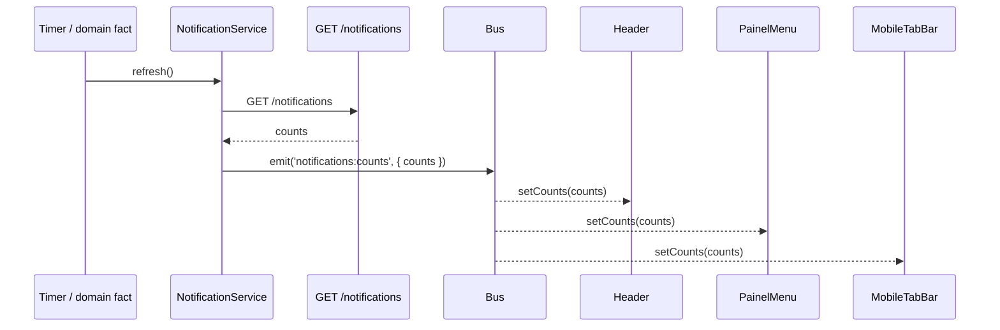
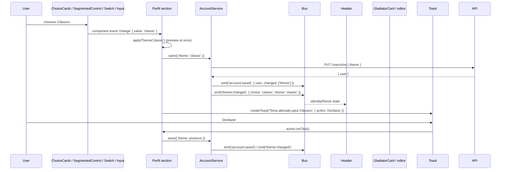
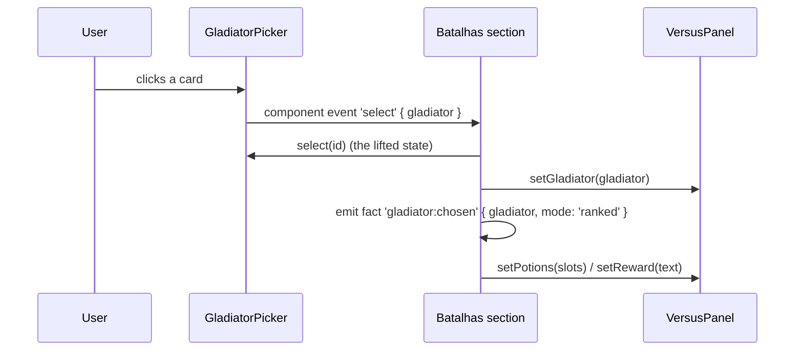
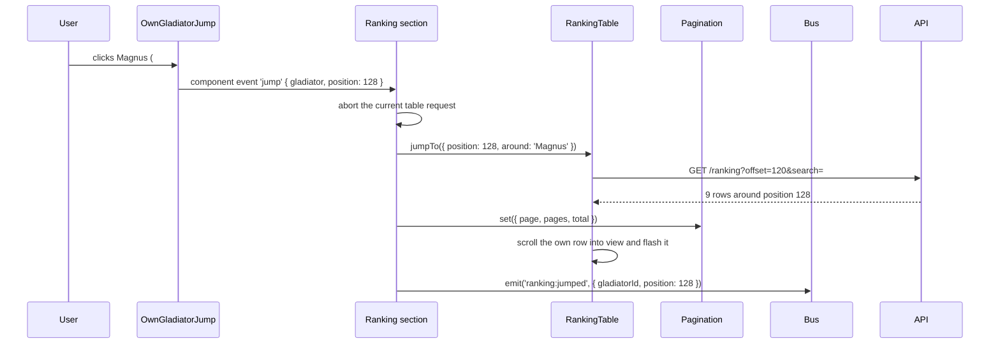
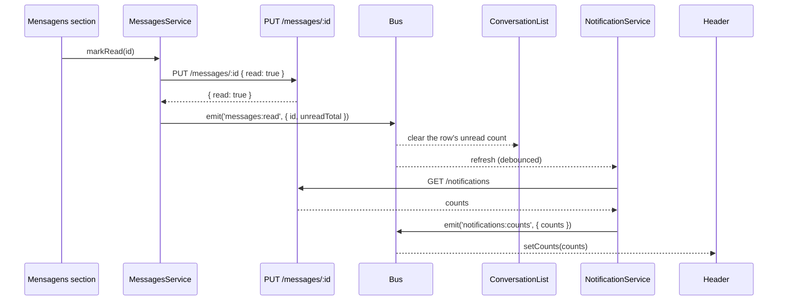
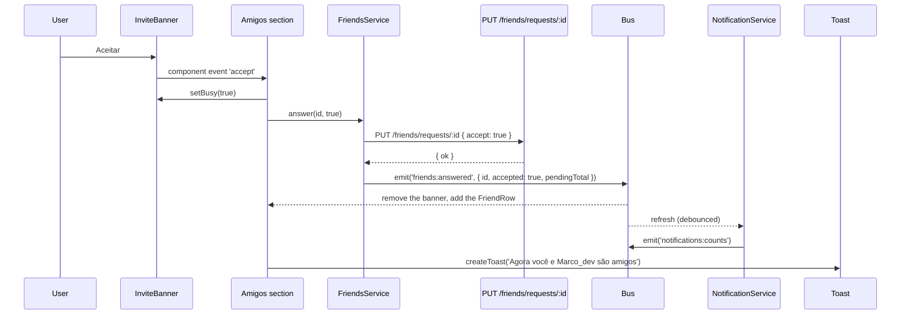
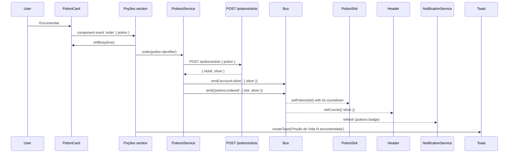
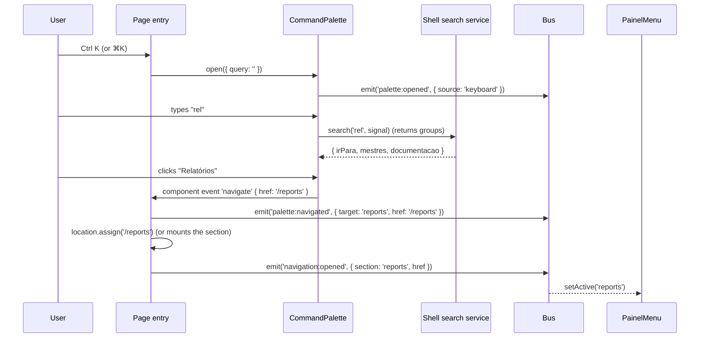

# Events

gladCode has two event levels, and they must not be confused:

| Level | Mechanism | Who owns it | Scope |
| :--- | :--- | :--- | :--- |
| **Component event** | A `CustomEvent` dispatched on the component's own root element, `bubbles: true` | The component | One subtree: a parent component or the section that mounted it listens |
| **App event** | The one DOM-free bus, `helpers/event-bus.js` | A service | The whole page: the shell, the header, the menu, the section and the tab bar |

A component event is not put on the bus. An app event is not a DOM event. Nothing else is allowed
(`document`-level `CustomEvent`s only survive until their consumers move to the bus; see
[Migration](#migration-of-the-existing-document-events)).

## Component events

- Name: a short verb in lower case — `select`, `change`, `save`, `undo`, `close`, `order`, `jump`,
  `navigate`, `retry`.
- Dispatched on the component root: `element.dispatchEvent(new CustomEvent('select', { detail, bubbles:
  true }))`.
- The `detail` payload is documented in [components.md](components.md) for each component.
- The parent either listens with `component.element.addEventListener('select', …)` (and `BaseComponent#on`
  for its own lifetime) or passes a method; there is no third way.
- Component events carry **view data** (the gladiator, the choice, the position), never a request, a
  service or an `AbortSignal`.

## The app event bus

`web/public/script/helpers/event-bus.js` (**planned, WP2**) is a single `EventTarget` wrapper. It is
DOM-free: it imports nothing and can be tested in `tests/frontend/`.

```js
// helpers/event-bus.js (target shape)
/**
 * @typedef {object} AccountSavedDetail
 * @property {object} user The account as the API returned it.
 * @property {string[]} changed The fields that changed.
 */
// …one typedef per event…

/** The only event names the bus accepts. */
export const APP_EVENTS = Object.freeze({
    accountLoaded: 'account:loaded',
    accountSaved: 'account:saved',
    accountSilver: 'account:silver',
    accountSignedOut: 'account:signed-out',
    themeChanged: 'theme:changed',
    gladViewChanged: 'glad-view:changed',
    notificationsCounts: 'notifications:counts',
    navigationOpened: 'navigation:opened',
    messagesRead: 'messages:read',
    friendsAnswered: 'friends:answered',
    potionsOrdered: 'potions:ordered',
    potionsCancelled: 'potions:cancelled',
    gladiatorChosen: 'gladiator:chosen',
    rankingJumped: 'ranking:jumped',
    paletteOpened: 'palette:opened',
    paletteNavigated: 'palette:navigated',
});

/** @type {{ on(name: string, handler: (detail: any) => void, options?: { signal?: AbortSignal }): () => void, emit(name: string, detail?: any): void }} */
export const events = new EventBus();
```

Contract:

- `on(name, handler, { signal })` returns an unsubscribe function. When `signal` is passed,
  `addEventListener(name, listener, { signal })` unsubscribes on abort; the returned function also works.
  A section passes its own `AbortController.signal` and does not have to track subscriptions.
- `emit(name, detail)` dispatches `new CustomEvent(name, { detail })`; it is synchronous.
- The name must be one of `APP_EVENTS`' values. `on()` and `emit()` throw on an unknown name in
  development and in tests, so a typo fails the suite instead of silently doing nothing.
- A handler receives the `detail` object, not the `CustomEvent`.
- `events` is the only instance; no module constructs another.

### Event names, payloads, emitters and listeners

Naming: `domain:action`. A **fact** is past tense (`account:saved`, `messages:read`,
`notifications:counts`). A fact says what just happened, not what someone should do.

| Event | Payload | Emitted by | Listened by |
| :--- | :--- | :--- | :--- |
| `account:loaded` | `{ user }` | `AccountService.load()` | shell, PainelMenu, AccountMenu, Settings section |
| `account:saved` | `{ user, changed: string[] }` | `AccountService.save()` | shell (header/menu identity), Settings section (`SaveStatus`), theme/glad-view helpers |
| `account:silver` | `{ silver }` | `AccountService.setSilver()` | AppHeader (the silver chip), AccountMenu |
| `account:signed-out` | `{}` | `AccountService.signOut()` | shell (return to the visitor header), NotificationService (stop polling) |
| `theme:changed` | `{ choice: 'system'\|'classic'\|'arena-light'\|'arena-dark', theme: 'classic'\|'arena-light'\|'arena-dark' }` | `helpers/theme.js` `applyTheme` | AccountMenu (pressed state), Settings section, any page that redraws on theme |
| `glad-view:changed` | `{ choice: 'sprite'\|'3d' }` | `helpers/glad-view.js` `applyGladView` | GladiatorCard/GladCardPainter, editor creator |
| `notifications:counts` | `NotificationCounts` (below) | `NotificationService.refresh()` | AppHeader (bell), PainelMenu (badges, identity), MobileTabBar, MoreSheet |
| `navigation:opened` | `{ section: SectionId, href: string }` | shell after a section mounts | PainelMenu (active entry), MobileTabBar, analytics, the route title |
| `messages:read` | `{ id: number, unreadTotal: number }` | `MessagesService.markRead()` | NotificationService (refresh), ConversationList |
| `friends:answered` | `{ id: number, accepted: boolean, pendingTotal: number }` | `FriendsService.answer()` | NotificationService (refresh), Amigos section |
| `potions:ordered` | `{ slot: PotionSlotView, silver: number }` | `PotionsService.order()` | Poções section (slot), AppHeader (silver via `account:silver`), NotificationService |
| `potions:cancelled` | `{ slotId: number }` | `PotionsService.cancel()` | Poções section |
| `gladiator:chosen` | `{ gladiator: GladiatorView, mode: 'ranked'\|'duel'\|'tournament'\|'training' }` | Batalhas section (after the picker's `select`) | Batalhas section itself for the URL, analytics |
| `ranking:jumped` | `{ gladiatorId: number, position: number }` | Ranking section (after the table moved) | shell (URL/hash), analytics |
| `palette:opened` | `{ source: 'keyboard'\|'button' }` | shell | analytics, the header search field (busy state) |
| `palette:navigated` | `{ target: string, href: string }` | CommandPalette → shell | analytics, PainelMenu (pending active state) |

Payload typedefs:

```js
/**
 * @typedef {object} NotificationCounts
 * @property {{ level: number, xp: number, silver: number }} user
 * @property {number} messages
 * @property {number} news
 * @property {number} friends
 * @property {{ remaining: number, outdated: number }} gladiators
 * @property {number} duels
 * @property {{ ranked: number, duel: number }} reports
 * @property {number} potions Expiring potions (the rail's “3 h”).
 */

/**
 * @typedef {object} PotionSlotView
 * @property {number} id
 * @property {string} identifier
 * @property {string} name
 * @property {string} icon
 * @property {number} seconds Time left.
 */

/**
 * @typedef {'news'|'profile'|'glads'|'potions'|'battle'|'reports'|'ranking'|'messages'|'friends'} SectionId
 */
```

### What must never go through the bus

- **Parent → child calls.** A section that mounts a `VersusPanel`, a `RankingTable` or a `MessageThread`
  calls its methods (`setGladiator`, `setRows`, `append`). The bus is not a way to call a child.
- **Child → parent replies.** A component emits its own event; the parent handles it directly.
- **Request payloads and responses.** Services call models; the bus carries the resulting *fact* and the
  view data, not an `AbortSignal`, a `Request` or an error object. (A failure is the promise's rejection;
  the section decides what to show.)
- **Secrets or private data.** No session token (there is none in JavaScript), no raw API bodies, no
  e-mail addresses that the section did not already display.
- **Styling or layout.** A theme fact is a fact; components read the tokens. Nothing emits “make this
  red”.

## Flows

### 1. Notification counts → header bell, menu badges and tab bar badges

`NotificationService` is the only owner of the counts. It refreshes on load, every 30 s while the page is
visible, and when a fact that changes a count arrives (debounced to one request per burst). The shell
passes the counts to the header, the menu and the tab bar through their setters.



The bell's `aria-label` includes the count (“Notificações, 4 novas”); a zero count removes the badge but
keeps the button. The menu badges use the three kinds from [components.md](components.md) (`action`,
`unread`, `info`). The 30 s poll stops on `account:signed-out`, `visibilitychange` and section unmount.

### 2. Profile setting changed → autosave → toast with undo → theme/glad-view applied everywhere

Text fields save when they lose focus or after a 700 ms pause; choices (theme, glad view, language,
switches) save immediately. The Perfil section keeps the previous value for the undo toast.



Rules:

- The preview happens before the request so the page does not flash; a refused save restores the previous
  value and shows `SaveStatus` in its error state with a retry.
- The toast action is the only undo; a second change in the same field supersedes the first toast.
- `glad-view:changed` has the same flow: `applyGladView` on change, `save({ gladView })`, the cards repaint
  in place (no reload, no reselection).
- The settings footer says “Tudo que você muda aqui é salvo na hora.” and the `SaveStatus` beside each
  field says “Salvo” / “Salvando…”; there is no save button (WP4).

### 3. Gladiator chosen in Batalhas → VersusPanel

The picker and the panel are siblings, both children of the Batalhas section. This is a **parent →
child** flow: no bus event coordinates it.



The panel disables “PROCURAR ADVERSÁRIOS” without a choice, keeps the previous choice when the list
reloads, and clears the opponent when the choice changes. A locked card (outdated or broken) is
`aria-disabled`; choosing it shows the reason, not a disabled-looking button with no explanation.

### 4. Ranking jump to own gladiator

The strip and the table are children of the Ranking section: the jump is a method call. The section then
publishes the fact (for the URL and analytics).



“Ir para a posição” uses the same path with a typed position; a position beyond the total clamps to the
last page and says so. The table keeps the “Você” tag and the own row's contrast in every theme.

### 5. Conversation read → Mensagens badge



Opening a conversation marks its unread messages read; the badge drops after the authoritative refresh,
never by decrementing a local number.

### 6. Friend invite accepted or declined → Amigos badge



Declining follows the same path with `accepted: false` and a neutral toast; a failure keeps the banner and
shows the message.

### 7. Potion ordered → Poções slots and silver in the header



A refused order (`NO_FREE_SLOT`, not enough silver) leaves the card enabled and shows the API's message; the
slot count and the silver never change locally before the API confirms. Cancelling emits
`potions:cancelled` and refreshes the same way.

### 8. Ctrl K → palette → navigation



The palette opens on `/` as well (the boards show the field in the header), traps focus, closes on Esc and
returns focus to the opener. On the phone the header search button opens the same palette.

## Migration of the existing document events

Today `helpers/theme.js` dispatches `themechange` on `document` and `helpers/glad-view.js` dispatches
`gladviewchange`, with `onGladViewChange` as the subscription helper. WP2 adds the bus names above; WP3
moves the last consumers (`GladiatorCard`, the header, the settings section) to `events.on` and deletes the
document events and `onGladViewChange`. Until then both paths exist, but **new code listens only to the
bus**.
